<!-- Animated art lives in ./assets — edit the name, tagline and "now:" pill inside assets/header.svg -->

  

  

### ✦ about me

- 👀 I'm interested in sleeping — it's where the side projects come from
- 🌱 Currently building playful products with **TypeScript**, **Python** & **Flutter**
- 🎡 Lately: in-app events and mini-games — lucky wheels, gacha pulls, story viewers
- 🎨 I sweat the small stuff: easing curves, empty states, design systems
- ✨ Fun fact: half my repos are named after the sky or dreams

 

<h3 align="center">✦ keeping the streak alive ✦</h3>

  

<h3 align="center">✦ a snake eats my contributions every midnight ✦</h3>

  <picture>
    <source media="(prefers-color-scheme: dark)" srcset="https://raw.githubusercontent.com/hungnq74/hungnq74/output/github-snake-dark.svg" />
    <source media="(prefers-color-scheme: light)" srcset="https://raw.githubusercontent.com/hungnq74/hungnq74/output/github-snake.svg" />
    
  </picture>

